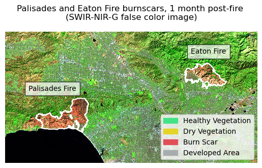

# EDS220-HW4: Visualizing fire scars through false color
This repository houses materials for Task 2 of HW4 for [EDS220 course](https://github.com/MEDS-eds-220/MEDS-eds-220-course/) at UCSB's Bren School of Environmental Science and Management. 

## About

This repository contains a notebook `hwk4-task2-false-color-KNAPP.ipynb` visualizing the burnscars from the 2025 Eaton and Palisades Fire using true color and false color imaging. The final false-color map is available in the `images/` directory

## Highlights
- Geospatial data wrangling with `geopandas`
- NetCDF raster data wrangling with `xarray` and `rioxarray`
- True and False color imaging with `matplotlib` and `xarray`

## Repository Structure

|File/folder name             | Contents                            |
|:----------------------------|:------------------------------------|
|README.md                    | README for the repository           |
|hwk4-task2-false-color-KNAPP.ipynb                | Analysis code document              |
|hwk4-task2-false-color-KNAPP.pdf                | Exportable analysis PDF             |
|images/                      | Exportable false color map          |
|LICENSE                      | Use license                         |
|.gitignore                   | Untracked files                     |                            

## Data access
Data used in this analyis is not housed in this repository.
Shapefiles for the Eaton and Palisades Fire perimeters were downloaded from the [County of LA](https://data.lacounty.gov/maps/ad51845ea5fb4eb483bc2a7c38b2370c/about).

Landsat imaging was obtained throuhg the [Microsoft Planetary Computer data catalog](https://planetarycomputer.microsoft.com/dataset/landsat-c2-l2)

## Authors
 - Olivia Knapp
 - [Carmen Galaz García](https://github.com/carmengg) (Instructor)

## References

County of Los Angeles. (2025). Palisades and Eaton Dissolved Fire Perimeters (2025). County of Los Angeles Open Data. https://data.lacounty.gov/maps/ad51845ea5fb4eb483bc2a7c38b2370c/about  

Earth Resources Observation and Science (EROS) Center. (2020). Landsat 8-9 Operational Land Imager / Thermal Infrared Sensor Level-2, Collection 2 [dataset]. U.S. Geological Survey. https://doi.org/10.5066/P9OGBGM6.

Riebeek, H. (2025). Why is that Forest Red and that cloud blue? how to interpret a false-color satellite image - NASA science. NASA Earth Observatory. https://science.nasa.gov/earth/earth-observatory/how-to-interpret-a-false-color-satellite-image/ 

U.S. Geological Survey. (2026). What are the band designations for the Landsat Satellites?. USGS. https://www.usgs.gov/faqs/what-are-band-designations-landsat-satellites 